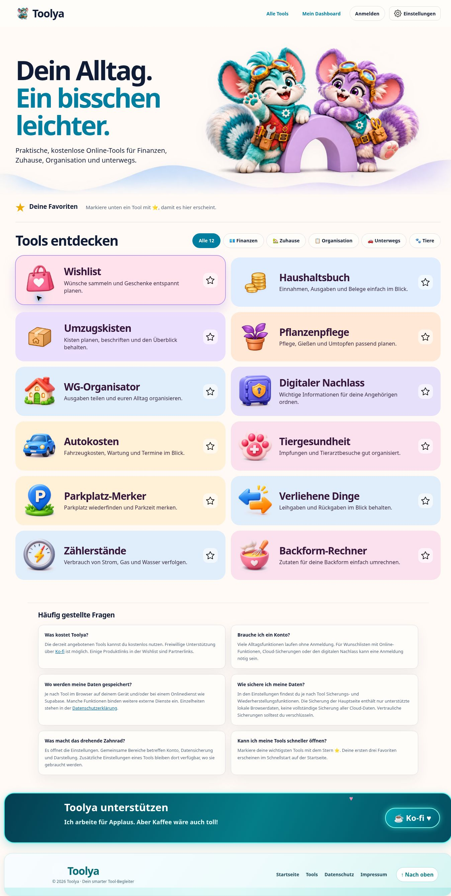
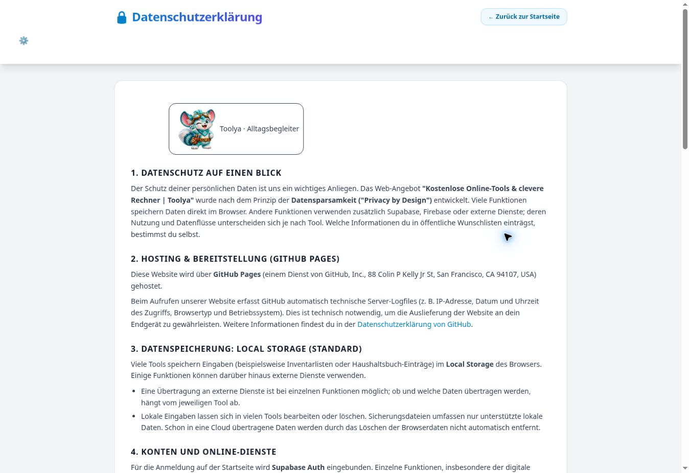
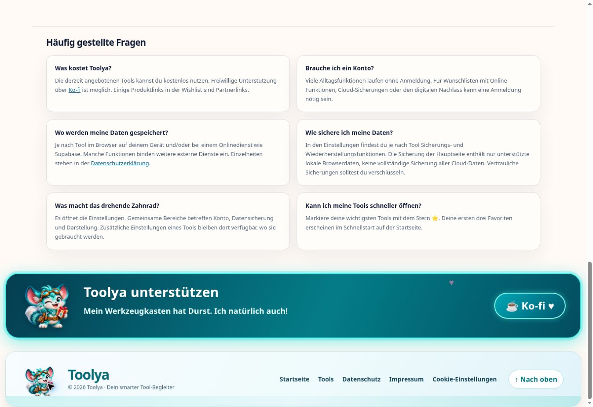

# Toolya – Master-Audit und Produktionsoptimierung

Stand: 16.11.2026. Ausgangscommit: `28f73ac3181f823cb5fc867ba8673c8461ea3fa9`.

## Management-Zusammenfassung

Toolya ist eine statische GitHub-Pages-Plattform mit zwölf Tool-Einstiegen, einem persönlichen Dashboard, eigenem Supabase-Backend und gemeinsamen Maskottchen-/Layoutmodulen. Der aktuelle Quellcode enthält 38 HTML-Seiten und 93 Remote-Branches (zuzüglich origin/HEAD). Drei alte PRs sind offen (#13, #26, #47); sie werden nicht ungeprüft integriert. Die letzten Plattform-, Amazon- und Pages-Läufe für den Ausgangscommit sind erfolgreich (43921114382, 43921114304, 43921113071).

Die Live-Startseite besitzt bereits die beschlossenen Originalmaskottchen und den gemeinsamen Footer. Ein Verlust des Cookie-Einstellungen-Links nach Footerersetzung ist live bestätigt. Die Datenschutzseite zeigt zwei Footer und eine zusätzliche Begleiterkarte. Wortmarken erben je nach Seite verschiedene Schriftfamilien; Pflanzen-/Tier-Header verwenden trotz Markenpräferenz Grün. Die Footer-CSS enthält zwei konkurrierende Ko-fi-Definitionen. Eine vollständige Designabnahme liegt noch nicht vor.

FAQ und Datenschutz enthalten nachweislich veraltete Aussagen zu Anmeldung, lokaler Speicherung und Firebase. Inhaltliche Änderungen folgen erst nach P1/P2, ausgenommen kritische Funktions-/Sicherheitskorrekturen. Rechtstexte sind nicht juristisch freigegeben.

Supabase-Metadatenprüfung: alle 32 public-Tabellen mit RLS, auch vier estate_private-Tabellen. Advisor-Warnungen sind keine automatisch bestätigten Schwachstellen. Insbesondere können fehlende Policies absichtlich jeden Clientzugriff sperren. Öffentliche Profile und WG-Schreibrechte benötigen gesonderte Detailprüfung. Keine produktiven Nutzerdaten wurden zum Test verändert.

## Verbindliche Gestaltung und Reihenfolge

P1 Design → P2 SEO → P3 Texte/Recht → weitere Optimierungen. Kritische Sicherheits-/Datenverlustfehler dürfen vorgezogen werden. Bestehende Hauptseite erhalten; gemeinsame Komponenten harmonisieren. Nur Hellmodus, bläuliches Türkis, beide Originalfiguren unverändert. Der aktuelle Auftrag verlangt Footer Variante 3 mit kleinem nutzergewähltem Maskottchen und überschreibt die ältere Entfernungsvorgabe. Themenfarbe und Charakterauswahl bleiben unabhängig. Original-PNGs über SHA256SUMS schützen.

## Belegstufen und Prüfgrenzen

- **Bestätigt:** aktueller Quellcode, aktuelle Live-DOM-/Screenshotbeobachtung oder aktuelle Metadatenabfrage belegt den Befund.
- **Wahrscheinlich:** Ursache im Code erkennbar; relevante End-to-End-Funktion noch nicht nachgewiesen.
- **Nicht prüfbar:** fehlender Sitzungskontext, echte Zustellung oder rechtliche Angaben fehlen.

Live-Browser: Startseite und Datenschutz bei ca. 1348 px; ausgeloggter Direktaufruf Haushaltsbuch führt auf die Startseite zurück. Keine echte Anmeldung und keine private Datenmutation. Keine Behauptung vollständiger WCAG-Konformität, realer Mobilgeräteabnahme oder gemessener Core Web Vitals.

## Maßnahmenkatalog und Fortschritt

Die vollständige erfasste Maßnahmenliste mit IDs, Gewichten, Ist/Soll, Aufwand, Abhängigkeiten, Risiken, Status und Nachweisen steht in [toolya-roadmap.md](toolya-roadmap.md). Die Seiteninventur steht in [page-inventory.json](page-inventory.json). Vertiefende Befunde stehen in [SEO-/Inhaltsinventar](seo-content-inventory.md) und [Sicherheitsinventar](security-inventory.md). Diese präzisieren die übergeordneten Aufgaben; ihre Unterpunkte werden nicht doppelt gewichtet. Prozentwerte beziehen sich ausschließlich auf den erfassten Katalog, nicht auf den unbekannten Gesamtumfang. Neue Befunde können den Nenner erhöhen.

## Qualitätsbewertung

| Bereich | Nachvollziehbare Bewertung | Grenze |
|---|---|---|
| Markenassets | Zwei bestehende Identitäten, Originale mit Prüfsummen vorhanden | Hashprüfung vor Integration erforderlich |
| Gemeinsame Komponenten | Header/Footer zentral vorhanden; Footer-Montage nachweislich inkonsistent | Private Tool-Inhalte nicht live abgenommen |
| Veröffentlichung | CI und Pages für Ausgangscommit erfolgreich | Jeder Folgecommit separat prüfen |
| Zugriffsschutz | Haushaltsbuch-Direktaufruf ausgeloggt umgeleitet; RLS auf 32 public-Tabellen aktiv | Kein vollständiger Funktions-/Angriffsnachweis |
| SEO | Inventar mit canonical/noindex vorhanden | Indexabdeckung, Rankings, CWV nicht gemessen |
| Inhalte | FAQ-/Datenschutzwidersprüche bestätigt | Juristische Freigabe offen |
| Analytics | Opt-in-Oberfläche vorhanden, Widerrufslink auf Startseite verloren | Tatsächliche GA4-Auswertung nicht Teil dieses Pakets |

## Bildschirmnachweise – Ausgangslage

1. Startseite: klare Toolkarten und Originalfiguren; FAQ mit veralteter Kontobehauptung. Footer-Widerrufslink fehlt im DOM nach Montage. Screenshot `evidence/01-home-before.jpg`.
2. Datenschutz: lesbare Textspalte, aber eigener Header und Begleiterkarte; zwei contentinfo-Footer im DOM. Screenshot `evidence/02-privacy-before.jpg`.
3. Ausgeloggter Haushaltsbuch-Direktaufruf: Rückleitung auf index.html bestätigt; damit ist keine private Tool-Bedienung geprüft.

## Integrations- und Rollback-Regeln

Neue Änderungen in eigenem Branch/PR. Nur nach relevanten Checks integrieren. Kein Datenbankschema in diesem ersten Designpaket ändern. Rollback über gezielten Revert des jeweiligen Mergecommits; Originalassets unberührt. Code vorhanden, PR integriert und live verifiziert werden getrennt dokumentiert. Ältere Release-Dokumente sind historische Nachweise, kein Beleg für den gesamten aktuellen Auftrag.

## Erstes Paket – Stand vor CI

D01–D04 im Branch implementiert. 75 bestehende Node-Tests bestanden; Syntax und Originalasset-Hashes erfolgreich. Lokaler Chromium-Start ist durch die Laufzeit gesperrt (socket Operation not permitted); Browserregression wird deshalb auf isoliertem GitHub-Runner ausgeführt. Cloud-Browser kann den lokalen Preview-Port nicht erreichen; Live-Sichtprüfung folgt nach erfolgreicher CI und Integration. Kein Sicherheitsmechanismus wird dafür abgeschaltet.

### CI-Nacharbeit

Der erste GA4-CI-Lauf 43925565469 scheiterte an einer älteren Testerwartung: Der Test verbot Analytics auf Nachlassseiten vollständig, während der aktuelle produktive Consent-Code diese Seiten ausdrücklich bei Einwilligung einbezieht. Die Produktfunktion wird nicht geändert. Der Regressionstest wird auf die bestehende Einwilligungsregel und insbesondere das Ausschließen von Query-Strings, Schlüsselfragmenten und Referrern aus page_view ausgerichtet. Die Footer-Wortmarkenprüfung normalisiert dekorative Leerzeichen; die Markenbezeichnung bleibt Toolya. Keine Abschwächung der Auth-/Tresorschutztests.

## HTTP-Baseline

Alle 38 inventarisierten HTML-Adressen am 16.11.2026 per GET abgefragt: 38 × HTTP 200, 38 Antworten bytegleich zu den HTML-Dateien des Ausgangscommits. Rohdaten: [live-http-baseline.json](live-http-baseline.json). Dies belegt statische Auslieferung; clientseitige Auth-Redirects und private Nutzerabläufe sind damit nicht abgenommen. Gemeinsame CSS/JS-Änderungen werden nach Deployment separat auf Bytegleichheit geprüft.

### Weitere visuelle Befunde im ersten Paket

Runner-Bilder für Pflanzenpflege, Startseite und öffentliche Wishlist bei 320 px gesichtet. Header-/Footer-Figuren folgen der lila Auswahl. Pflanzenheader ist bläulich, grüne Bedienelemente im Tool bestehen weiterhin (D06). Zahlreiche andere ältere Maskottchen-Routenscreenshots zeigen nach dem Auth-Redirect die Startseite; sie zählen nicht als echte Tool-Designabnahme. Öffentliche Wishlist: allgemeines section-Padding verengt den gemeinsamen Header zusätzlich; gemeinsamer Header erhält ausdrücklich padding:0, die innere Komponente behält ihre Abstände. Ein künstliches zusätzliches Sternsymbol vor dem bereits vorhandenen Herz entfällt. Der neue Layouttest erfasst auch diese echte öffentliche Route.

OpenSEO-Projekt Toolya (6eddcfc6-d4a2-403b-a689-d02bc761a969) ist verbunden, sein Kontext und Research-Log sind leer. Noch keine kostenpflichtige Recherche gestartet. Amplitude ist erreichbar, aber das Projekt default ist nicht belastbar Toolya zugeordnet; daraus werden keine Nutzerkennzahlen abgeleitet.

### Nachgewiesener 320-px-Fehler

Der neue responsive Test zeigte auf privacy.html eine Dokumentbreite von 354 px bei 320 px Viewport: der Zurück-Link ragte rechts aus der nicht umbrechenden Headerzeile. Datenschutz und Impressum erhalten einen umbrechenden Header mit Abstand. Das ist eine gezielte Korrektur im P1-Paket; Inhalt/Rechtsaussagen bleiben unverändert. Nachweis: CI 43926412098, platform-Job 133506951996.

Der nachfolgende Test fand auf Impressum zusätzlich das untrennbare Wort Verbraucherstreitbeilegung (337 px Dokumentbreite bei 320 px). Beide Rechtstextspalten erhalten Wortumbruch. Die dortige Viewport-Sperre gegen Benutzerzoom wird entfernt; Textinhalt bleibt unverändert. Fehlerbild aus Runner-Artefakt 14257311127 visuell bestätigt.

## Verifizierter Abschluss des ersten P1-Pakets

PR [#91](https://github.com/duhrrom11/toolya/pull/91) gemergt. Releasecommit `1b611811afddef8bd0da78da00ba50c66cd896ea`. Alle sechs Checks am PR-Head `33180514506ad8fd73992935182d8a28c06143bf` erfolgreich: estate-security, platform, isolated, browser, privacy, isolated-browser-tests. Plattform-/Nachlasslauf [43927647192](https://github.com/duhrrom11/toolya/actions/runs/43927647192). Pages [43928099016](https://github.com/duhrrom11/toolya/actions/runs/43928099016) erfolgreich.

Die sieben geänderten Produktdateien wurden live per GET auf Bytegleichheit geprüft: Consent, Plattformmodul, Tokens, Footer-CSS, Header-CSS, Datenschutz und Impressum – alle identisch. Live-Browser bestätigt einen Footer auf Startseite/Datenschutz/Impressum, Cookie-Link in gemeinsamer Footernavigation, echtes erneutes Öffnen/Ablehnen der Statistikeinstellungen und identische berechnete Schriftfamilie in Header/Footer. Beide Charaktere und vier Seiten bei 320/768/1440 px im isolierten Runner geprüft; Original-PNGs unverändert. Nachlass-Sicherheitsprüfungen unverändert erfolgreich. Keine produktiven Daten geändert.

### Aktuelle Fortschrittswerte

Sieben von 22 übergeordneten Aufgaben verifiziert; 15 noch offen oder in Arbeit. Bestandsaufnahme 5/8 Gewichtspunkte = 62,5 %, P1 7/17 = 41,2 %, P2 0/9, P3 0/8, weitere Optimierungen 0/10. Nicht alle privaten Toolzustände live geprüft; kein Gesamtabnahmeversprechen. Zusätzlicher wahrscheinlicher Analytics-Doppelladungsbefund X05 ergänzt; die Änderung des Nenners ist transparent in der Roadmap erfasst.

### Visueller Nachweis

1. Startseite – gemeinsame Marke/Toolkarten erhalten; Footer und Cookie-Link korrigiert. Status: geprüft im Umfang des ersten Pakets.
2. Datenschutz/Impressum – jeweils ein Footer, 320-px-Umbruch und freier Browserzoom. Status: Darstellung geprüft; Inhalts-/Rechtsprüfung offen.
3. Öffentliche Wishlist – gemeinsame Headerabstände korrigiert; drei Breiten isoliert geprüft. Status: Darstellung des Pakets geprüft; vollständige Such-/Import-/Kontoflüsse nicht abgenommen.
4. Haushaltsbuch ausgeloggt – Direktaufruf führt zur Startseite. Status: Auth-Umleitung beobachtet, private Oberfläche nicht als live geprüft gezählt.

Die ursprünglichen Zwischenstände weiter oben beschreiben den Weg bis zur Verifikation. Dieser Abschluss ist für PR #91 maßgeblich. Die [Designfamilienmatrix](design-family-inventory.md) beschreibt die nächste konkrete P1-Einheit. Design, SEO und Inhalte bleiben getrennte, noch nicht vollständig abgeschlossene Phasen.

Auch die main-Läufe nach dem Merge sind erfolgreich: Plattform/Nachlass 43928099143, Amazon 43928099197, isolierte Browser 43928099189.

## Zweites P1-Paket – Nachlass Besitzer und Vertrauenspersonen

Ausgangscommit `80247443ab3120342bfc07faef3fc4b438172f76`, Branch `audit/estate-design-turquoise-20261116`. Aktuelle Live-Besitzeransicht bestätigt grünliche UI-Flächen. Die Vertrauenspersonenseite besitzt zusätzlich zum gemeinsamen Footer einen eigenen Footer mit Schlüsselhinweis. Dieser wichtige Hinweis wird in main bewahrt, sodass nur der gemeinsame Footer bleibt.

D06 wird ohne Gewichtserhöhung in D06a (Nachlass Besitzer/Erben, Gewicht 1) und D06b (übrige Formulare/Karten, Gewicht 2) geteilt. 23 Aufgaben, weiterhin 7 verifiziert; noch kein neuer Fortschritt vor Browserprüfung. CSS greift auf die bestehenden Markenfont-/Primärfarb-Tokens zurück, grüne Flächen werden bläulich, inaktive Dark-Mode-Overrides entfernt. Rot bleibt für kritische Aktionen erhalten. Hover-/Druckbewegung bleibt erhalten; die kontrastsenkende Helligkeitsfilterung entfällt. Rechnerischer Weißtext-Kontrast auf #007e9f: 4,68:1; Browserkontrast wird zusätzlich geprüft. Keine vollständige WCAG-Zertifizierung behauptet.

75 bestehende Node-Tests lokal bestanden. Bestehende responsive Prüfung wird um Besitzer-Login und Vertrauenspersonenzugang bei 320/768/1440 px erweitert, einschließlich Hellmodus bei dunkler Systemeinstellung, Tastaturfokus, Primärbutton-Kontrast und erhaltenem Schlüsselhinweis. Die echte isolierte Nachlass-Sicherheitsprüfung deckt weiter Anmeldung, Verschlüsselung, Zwei-Schlüssel-Regel, 24h-Frist, Entwarnung und Sperren ab und speichert zusätzliche Bilder des geöffneten synthetischen Tresors. Keine Testdaten oder Alarme in Produktion.

Unabhängige Codeprüfung: keine CSP-/Auth-/Schlüssel-/Freigabeänderung; Hinweistext erhalten. `handover.html` und `print-key.html` sind von diesem Paket ausgenommen und unverändert. Die eigenständige Übergabeseite folgt separat, weil ihr CSP externes CSS und Netzwerkzugriffe sperrt.

Die Bildprüfung des geöffneten synthetischen Tresors zeigte außerdem kurzzeitig schlechten Tab-Kontrast während des Hintergrund-Farbwechsels. Die Nav-Farben wechseln nun sofort; Schatten-/Druckeffekte bleiben erhalten. Die isolierte Prüfung misst nach jedem der vier Tabwechsel den tatsächlichen Kontrast aller Navigationsbuttons. Cookie-Overlay und vorangegangene Speichermeldung werden nur in der synthetischen Bildschirmaufnahme entfernt, damit die Oberfläche erkennbar ist.

Bei 320 px zeigten die Bilder außerdem mitten im Wort umgebrochene Reiterbeschriftungen. Bis 380 px stehen die vier Nachlass-Reiter deshalb untereinander; die übrigen Breiten behalten die vorhandene Anordnung. Die bestehenden 320/375/768/1280/1440-px-Prüfungen kontrollieren den Umbruch.

### D06a veröffentlicht und bestätigt

PR #93 gemergt, Release `384d5856578e578934a82168639969b2bfa41eb7`. Alle vier Checks am Head `798634c581e7a4fb3c554efa89b2517da348e436` erfolgreich, Lauf 43932478466. Pages 43933043137 erfolgreich. Live-DOM: helles Farbschema, Primärbutton #007e9f, je ein Footer, Schlüsselhinweis im main, private Besitzeroberfläche ohne Anmeldung verborgen. Beide Produktdateien live bytegleich. Screenshots des geöffneten Tresors stammen ausschließlich aus synthetischer isolierter DB; Screenshots 07/08 zeigen den tatsächlichen öffentlichen Live-Einstieg.

## D05a – eigenständige Dateiübergabe in Hellmodus

Ausgangslage live erfasst: dunkles Farbschema und unvollständig gestaltete gemeinsame Komponenten. Plan nach gezielter Sicherheitsprüfung angepasst: style-src erhält zusätzlich self, um ausschließlich eigene Stylesheets zu laden. Alle anderen CSP-Direktiven bleiben identisch, insbesondere connect-src none, script-src self, img-src self data und form-action none. Eigene statische Ressourcen bleiben Netzwerk-GETs; eine absolute Behauptung keinerlei Netzwerk wäre falsch. Ziel ist, keine Schlüssel, Passwörter oder Inhalte zu übertragen.

Der Krypto-Code assets/heir-e2ee-handoff.js ist unverändert. Ein statischer Vergleich bestätigt alle elf ursprünglichen input-/button-Elemente identisch. Neue Darstellung verwendet bestehende Marken-Tokens, gemeinsamen Header/Footer und helles lesbares Inline-Grunddesign. referrer=no-referrer verhindert die Weitergabe der Seitenadresse als Referrer. Nur die exakten lokalen Routen handover.html und print-key.html werden von Analytics ausgeschlossen; normale Nachlassseiten bleiben bei Einwilligung erfasst. Die Druckseite selbst bleibt unverändert und ohne Plattformimporte.

Neue isolierte Browserprüfung: drei Breiten, dunkle OS-Einstellung mit hellem Ergebnis, Fokus, erlaubte feste Assetpfade, gespeicherte Analytics-Zustimmung ohne dataLayer/Google-Script, unveränderte CSP-Datengrenzen, Passwortgeschützter Schlüssel-Download, öffentliche Schlüsseldatei, ausdrücklich bestätigter Export, realer RSA/AES-Dateirundlauf, falsches Passwort, textContent statt HTML sowie Kontrolle aller Requests auf synthetische Geheimnisse. Keine echten Dateien oder Nutzerkonten. 75 bestehende Node-Tests erneut erfolgreich; Browser-/Produktionsverifikation noch offen.

D05 ist ohne Gewichtsänderung in D05a (1) und D05b (4) geteilt. Aktuell 24 Aufgaben, 8 verifiziert; P1 8/17 = 47,1 %. Historische Zwischenstände oben bleiben als Nachweise bestehen.
